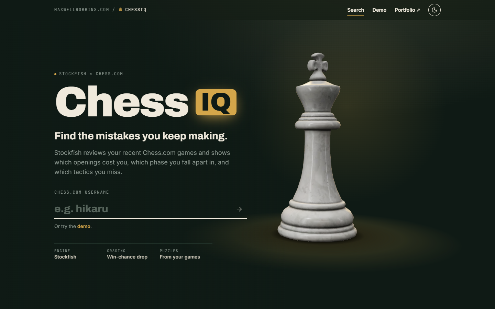

# ChessIQ

**Find the mistakes you keep making.** Enter a Chess.com username. ChessIQ imports your recent games, has Stockfish grade every move, and shows the patterns behind your losses: weak openings, the phase you fall apart in, the tactics you miss, and how it all trends over time.

**Live:** [maxwellrobbins.com/chessapp](https://maxwellrobbins.com/chessapp/) · [demo report](https://maxwellrobbins.com/chessapp/player/?u=gothamchess)



## What it does

- **Imports** your most recent games from Chess.com's public API. There's no login, just a username.
- **Grades every move with Stockfish.** A move is judged by how much winning chance it gave away, the same way Lichess does it, not by raw centipawns. Each move is classified as Best, Good, Inaccuracy, Mistake or Blunder, and gets an accuracy score.
- **Explains your errors.** Each mistake is tagged with what the opponent's best reply exploits: a hung piece, an allowed fork, an allowed mate, a back-rank mate, a missed mate, or time trouble.
- **Finds patterns.** Results are broken down by game phase (opening, middlegame, endgame), by opening and color, by month, by opponent rating gap, by hour of day, and by time control.
- **Builds a study plan.** Your weaknesses are ranked, and the puzzles come from positions where *you* went wrong. You solve them on a click-to-move board.
- **Game review.** Step through any game with an evaluation graph, move-by-move grades and the engine's best move.

## Architecture

```
 Browser ──► Next.js static site (GitHub Pages, /chessapp)
               │  TanStack Query, fetch
               ▼
            FastAPI (Docker on Render) ──► Chess.com public API
               │  SQLModel
               ▼
            Postgres (Neon) / SQLite locally
               ▲
            analysis workers ── one Stockfish process each
```

| Part | Stack |
|---|---|
| Backend | Python 3.12, FastAPI, SQLModel, python-chess, pandas, Alembic, slowapi |
| Analysis | Stockfish in a global queue: `ANALYSIS_WORKERS` threads, each owning one single-threaded engine |
| Frontend | Next.js 16 (App Router, static export), React 19, Tailwind 4, TanStack Query, Recharts, motion, react-three-fiber |
| Hosting | Render (API, Docker), Neon (Postgres), GitHub Pages (site) |

### Backend modules (`backend/app/`)

| Module | Role |
|---|---|
| `main.py` | HTTP routes, CORS, rate limits; runs migrations and starts the workers at startup |
| `chesscom.py` | Chess.com API client (descriptive `User-Agent`, one request at a time) and opening names |
| `models.py` | `Player`, `Game`, `MoveAnalysis` tables |
| `analysis.py` | Stockfish evaluation, win-chance conversion, move classification and accuracy |
| `jobs.py` | The global analysis queue and its workers |
| `patterns.py` | Tactic tags, from the position after your move plus the opponent's best reply |
| `stats.py` | pandas aggregation, the study plan, and puzzle selection. The moves DataFrame is cached per user |
| `db.py` | Engine setup (SQLite WAL locally, Postgres in production) and `run_migrations()` |

### Frontend (`frontend/src/`)

| Path | Role |
|---|---|
| `app/page.tsx` | Home: hero with the 3D king and the username search |
| `app/player/` | Player report: Overview, Openings, Weaknesses, Study plan and Games tabs (`/player?u=&tab=`) |
| `app/game/` | Game review with board, eval graph and move list (`/game?id=&ply=&u=`) |
| `components/HeroKingScene.tsx` | three.js hero scene (see the [frontend README](frontend/README.md)) |
| `components/motion.tsx` | Shared motion pieces: `Reveal`, `NumberTicker`, `SpotlightCard`, `Segmented` |
| `lib/api.ts` | Typed API client; set `NEXT_PUBLIC_API_URL` to point it at the backend |

## Quick start

**Prerequisites:** Python 3.12+, Node 24, and [Stockfish](https://stockfishchess.org/download/) installed.

### Backend

```bash
cd backend
python -m venv .venv
.venv/Scripts/python -m pip install -r requirements.txt   # macOS/Linux: .venv/bin/python
cp .env.example .env    # then set STOCKFISH_PATH, or put `stockfish` on your PATH
.venv/Scripts/python -m uvicorn app.main:app --reload
```

The API runs at http://127.0.0.1:8000, with interactive docs at http://127.0.0.1:8000/docs. Migrations run automatically at startup, and a local `chessiq.db` SQLite file is created on first run.

### Frontend

```bash
cd frontend
npm install
NEXT_PUBLIC_API_URL=http://127.0.0.1:8000 npm run dev
```

Open http://localhost:3000/chessapp.

## Configuration

Backend settings are environment variables. Locally they're read from `backend/.env`.

| Variable | Default | Meaning |
|---|---|---|
| `DATABASE_URL` | `sqlite:///chessiq.db` | Database. `postgres://` URLs are rewritten to the psycopg driver automatically |
| `STOCKFISH_PATH` | `stockfish` | Path to the Stockfish binary |
| `ANALYSIS_DEPTH` | `12` (Docker: `10`) | Fixed search depth per position |
| `ANALYSIS_WORKERS` | min(4, CPU cores − 1) (Docker: `1`) | Parallel Stockfish processes |
| `MAX_IMPORT` | `100` | Most games one import may fetch |
| `ALLOWED_ORIGINS` | `http://localhost:3000,http://127.0.0.1:3000,https://maxwellrobbins.com` | CORS origins, comma-separated |
| `RUN_WORKER` | `1` | Set to `0` to start the API without analysis workers (the tests do this) |
| `FRONTEND_URL` | `https://maxwellrobbins.com/chessapp/` | Where the API root (`/`) redirects |

Frontend settings are read at build time:

| Variable | Default | Meaning |
|---|---|---|
| `NEXT_PUBLIC_API_URL` | `http://127.0.0.1:8000` | Backend base URL |
| `NEXT_PUBLIC_BASE_PATH` | `/chessapp` | Path the site is served under (`""` serves it from the root) |

## API

All player routes lowercase the username. Write routes are rate-limited per IP.

| Method | Route | Purpose |
|---|---|---|
| GET | `/health` | Liveness check (also wakes a sleeping free-tier server) |
| POST | `/players/{u}/sync?limit=50` | Import recent games and queue all unanalyzed ones. **5/min** |
| POST | `/players/{u}/import?limit=50` | Import only. **10/min** |
| POST | `/players/{u}/analyze` | Queue unanalyzed games. **10/min** |
| GET | `/players/{u}/analysis-status` | Queue progress: counts by status, and games from other players ahead of yours |
| GET | `/players/{u}/games?limit=50` | Game list, newest first (max 500) |
| GET | `/games/{id}/moves` | One game with every analyzed move |
| GET | `/players/{u}/stats/overview` | Headline stats, move-quality split, rating, monthly and per-hour trends |
| GET | `/players/{u}/stats/openings?min_games=3` | Results and opening-phase errors by opening and color |
| GET | `/players/{u}/stats/weaknesses` | Errors by phase and tactic, time-trouble rates |
| GET | `/players/{u}/study-plan` | Ranked priorities, plus puzzles from your own mistakes |
| GET | `/` · `/legacy` | Redirect to `FRONTEND_URL` · the original vanilla-JS dashboard |

## How the analysis works

1. **Fixed engine limits.** Every position is searched at a fixed depth by a single-threaded engine, so the same game always gets the same grades.
2. **Mover's point of view.** Evaluations are stored from the side that moved: `eval_before` and `eval_after` in centipawns, with mate in N stored as ±(10000 − N).
3. **Win chance.** Centipawns are converted to win%: `50 + 50·(2 / (1 + e^(−0.00368·cp)) − 1)`.
4. **Grades.** A move's *drop* is win% before minus win% after. A move that matches the engine's choice is **Best**. Otherwise, a drop of 5 or more is an **Inaccuracy**, 10 or more a **Mistake**, and 15 or more a **Blunder**; anything less is **Good**.
5. **Accuracy.** Per move: `103.17·e^(−0.0435·drop) − 3.17`, clamped to 0–100. A game's accuracy is the average over your moves.

**Throughput.** Workers claim games oldest-first across all users, with a conditional `queued → analyzing` update, so no two workers take the same game. Games interrupted by a restart are re-queued at startup. Locally, 50 games import and analyze in about 35 seconds with 4 workers. The hosted free tier runs a single worker on a fraction of a CPU, so it's much slower there.

## Testing and quality

```bash
cd backend && .venv/Scripts/python -m pytest -q
cd frontend && npx tsc --noEmit && npx eslint src && npm run build
```

The backend tests use a temporary SQLite database. The Stockfish-dependent tests are skipped if no engine is found.

## Deployment

- **Backend:** `render.yaml` defines a Docker web service (`backend/Dockerfile`, which installs Stockfish). Set `DATABASE_URL` to your Neon connection string in the Render dashboard.
- **Frontend:** `.github/workflows/pages.yml` builds the static export on pushes to `main` that touch `frontend/`, and publishes `frontend/out` to GitHub Pages. Set the repository variable `NEXT_PUBLIC_API_URL` to the Render URL.
- **Migrations:** Alembic runs at startup. After a model change, run `alembic revision --autogenerate -m "…"` from `backend/` and review the file it creates.

## Credits

- 3D king model: [“Chess Set” by Riley Queen](https://polyhaven.com/a/chess_set), Poly Haven, CC0. The kings are trimmed out of it by `frontend/scripts/prepare-king.mjs`.
- [Stockfish](https://stockfishchess.org/) (GPLv3), run as a separate process.
- Game data from the [Chess.com public API](https://www.chess.com/news/view/published-data-api).
- Move grading and accuracy formulas follow [Lichess](https://lichess.org/page/accuracy).
